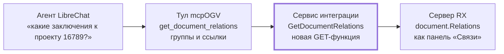
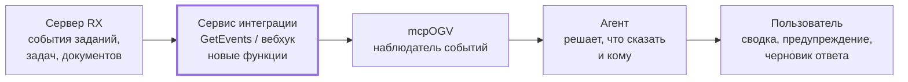
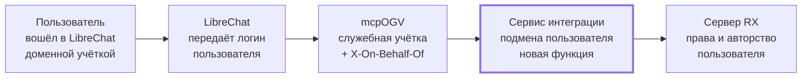

# Требования к сервису интеграции Directum RX для ИИ-агентов

20.10.2026 · для разработчика сервиса интеграции Directum RX

Прототип mcpOGV (MCP-сервер для ИИ-агентов поверх Directum RX 26.2, стенд governmentgenai.directum360.ru) упирается в три пробела сервиса интеграции. Без них демонстрации агентов либо дают неполные ответы, либо работают в обход прав RX.

| Часть | Чего не хватает | Что даёт агентам | Приоритет |
| --- | --- | --- | --- |
| [1](#часть-1-чтение-связей-документов) | Чтение связей документов | Полные досье документов, «письмо ↔ ответ», комплектность пакета | Высокий |
| [2](#часть-2-события-и-подписки) | События и подписки | Проактивные агенты: сами сообщают о новых заданиях и срывах сроков | Высокий |
| [3](#часть-3-действия-от-имени-пользователя) | Действия от имени пользователя | Права и авторство как у человека, а не у Administrator | Высокий |

---

## Часть 1. Чтение связей документов

### Зачем это нужно

Нужна одна GET-функция сервиса интеграции, которая отдаёт связи документа так же, как панель «Связи» в карточке RX. Без неё прототип mcpOGV не может построить инструмент поиска по связям: сейчас связи можно только создать (`Docflow/AddRelations`), но не прочитать.

Пример со стенда — проект правового акта 16789 «О региональном стандарте максимально допустимой доли расходов граждан…». В карточке RX у него пять связей, через API подтверждается одна:

| Группа в панели «Связи» | Документ | Id | Виден через API |
| --- | --- | --- | --- |
| Нормативный правовой акт | Правовой акт №001/26 от 14.10.2026 | 16808 | Да, через поле `ProjectId` акта |
| Заключения и отчеты | Заключение ОРВ «ОРВ о стандарте доли расходов граждан» | 16809 | Нет |
| Заключения и отчеты | Объявление об антикоррупционной экспертизе | 16806 | Нет |
| Прочие | Объявление об общественном обсуждении | 16807 | Нет |
| Прочие | Пояснительная записка | 16805 | Нет |

Агент на этих данных ответил пользователю, что других связей нет, и подставил чужой принятый акт с тем же номером «001/26» от 19.01.2026. Задачи, которые закрывает функция: досье проекта НПА (заключения, экспертизы, пояснительные записки), переход «письмо ↔ ответ», «документ ↔ основание», проверка комплектности пакета перед согласованием.

### Что есть в API сейчас

Читающего метода для связей нет ни в OData (`Integration/odata`), ни во встроенном MCP RX. Проверено по `$metadata` стенда и живыми запросами под Administrator.

| Что искали | Результат |
| --- | --- |
| EntitySet со связями (`*Relation*`) | Нет ни одного |
| Функции и действия с Relat / Related / Link в имени | Только запись: `Docflow/AddRelations(relationName, baseDocumentId, relationDocumentId)` |
| Свойства документа | `HasRelations` (bool) — связи есть, но какие — неизвестно |
| Встроенный MCP RX (`IntegrationAIAgent/HandleMcpRequest`) | 6 инструментов (сотрудники, организации, обращения, поручения), связей нет |

Обходные пути, которые прототип уже использует, покрывают лишь частные случаи:

| Обходной путь | Что даёт | Ограничение |
| --- | --- | --- |
| `LeadingDocument` | Приложения к документу | Только связь «Приложение»; у 16805–16809 поле пустое |
| `ProjectId` (решение «Правовые акты») | Проект ↔ принятый акт | Только эта пара |
| Вложения задач (`AttachmentDetails`) | Документы, отправленные в одной задаче | Это не связи; 16805–16809 не вложены ни в одну задачу |
| Похожее название + период + `HasRelations` | «Вероятно связанные» документы | Связь не подтверждена, тип связи неизвестен; документ с другим названием пропускается |

Надёжно закрыть задачу можно только серверной функцией RX, опубликованной в сервисе интеграции: на сервере связи доступны через `document.Relations` (так же, как их читает панель «Связи»).

### Функциональные требования

Нужны три публичные серверные функции с `WebApiRequestType = Get`, опубликованные рядом с `Docflow/AddRelations` (модуль — на усмотрение разработчика). Обязательны ФТ-1.1 и ФТ-1.2, ФТ-1.3 — желательно.

| № | Функция | Параметры | Что возвращает | Приоритет |
| --- | --- | --- | --- | --- |
| ФТ-1.1 | `GetDocumentRelations` | `documentId` (long, обяз.); `relationNames` (строка через запятую, пусто — все); `direction`: `Both` (по умолчанию), `From`, `To` | Все связи документа в обе стороны — то же, что панель «Связи» | Обязательно |
| ФТ-1.2 | `GetRelationTypes` | — | Справочник типов связей: системное имя, заголовки групп для обеих сторон, между какими типами документов допустима | Обязательно |
| ФТ-1.3 | `GetDocumentsRelations` | `documentIds` (до 50 Id через запятую); `relationNames`; `direction` | То же, что ФТ-1.1, для нескольких документов за один вызов (досье, граф на 2–3 уровня) | Желательно |

Поля одной связи в ответе ФТ-1.1 и ФТ-1.3:

| Поле | Тип | Значение |
| --- | --- | --- |
| `DocumentId` | long | Документ, для которого запрошены связи (важно для ФТ-1.3) |
| `RelationName` | string | Системное имя типа связи — то же, что принимает `AddRelations` |
| `GroupTitle` | string | Заголовок группы, как в панели «Связи» для этой стороны: «Заключения и отчеты», «Прочие» |
| `Direction` | string | `From` — запрошенный документ источник связи, `To` — цель |
| `RelatedId` | long | Id связанного документа |
| `RelatedName` | string | Имя связанного документа |
| `RelatedKind` | string | Вид документа («Заключение ОРВ») |
| `RelatedTypeGuid` | string | GUID типа — для ссылки на карточку и выбора набора OData |
| `RegistrationNumber`, `RegistrationDate` | string, date | Регистрационные данные, если есть |
| `Created` | datetime | Когда создан связанный документ |
| `HasVersions` | bool | Есть ли текст — можно ли читать содержимое |

Ожидаемый ответ ФТ-1.1 для проекта 16789 (сокращённо, системные имена связей — примерные):

```json
[
  {"DocumentId": 16789, "RelationName": "Conclusion", "GroupTitle": "Заключения и отчеты", "Direction": "From",
   "RelatedId": 16809, "RelatedName": "Заключение ОРВ «ОРВ о стандарте доли расходов граждан»",
   "RelatedKind": "Заключение ОРВ", "Created": "2026-10-14T14:20:06+04:00", "HasVersions": true},
  {"DocumentId": 16789, "RelationName": "LegalAct", "GroupTitle": "Нормативный правовой акт", "Direction": "From",
   "RelatedId": 16808, "RelatedName": "Правовой акт №001/26 от 14.10.2026 …", "RegistrationNumber": "001/26"},
  {"DocumentId": 16789, "RelationName": "Simple relation", "GroupTitle": "Прочие", "Direction": "From",
   "RelatedId": 16805, "RelatedName": "Пояснительная записка …", "RelatedKind": "Пояснительная записка"}
]
```

Правила:

1. Состав и группировка совпадают с панелью «Связи» для того же пользователя, включая приложения и прикладные типы решения «Правовые акты».
2. Неизвестное имя в `relationNames` — ошибка с перечнем допустимых имён, а не пустой список.
3. Документ без связей — пустой массив и код 200.

### Нефункциональные требования

Функции только читают и не дают больше, чем карточка RX тому же пользователю.

| Требование | Значение |
| --- | --- |
| Права | Выполняется от имени вызывающего пользователя. Документ без права на чтение не попадает в ответ; число скрытых — в поле `HiddenCount`, без имён |
| Исходный документ не найден или нет доступа | Код 404 и понятный текст ошибки |
| Неверные параметры | Код 400; текст называет параметр и допустимые значения |
| Скорость | ФТ-1.1 — до 1 с для документа с 50 связями; ФТ-1.3 — до 3 с для 50 документов |
| Объём ответа | До 500 связей на документ; сверх того — признак `Truncated` или параметры `skip`/`top` |
| Формат | JSON; даты в ISO 8601 со смещением, как в остальном OData |
| Вызов | GET с параметрами в строке запроса; без символа «+» в пути (IIS стенда отвечает 404) |
| Совместимость | Имена функций и полей не меняются между версиями; новые поля добавляются без удаления старых |

### Критерии приёмки

- [ ] `GetDocumentRelations(16789)` возвращает 5 связей: 16805, 16806, 16807, 16808, 16809 — с теми же группами, что в панели «Связи»
- [ ] `GetDocumentRelations(16809)` возвращает обратную связь на 16789 с `Direction = To`
- [ ] Фильтр `relationNames` по связи «Заключения и отчеты» оставляет только 16806 и 16809
- [ ] Приложения приходят как связи: для документа 15951 есть 16811, 16812, 16813
- [ ] Связь, созданная через `Docflow/AddRelations`, сразу видна в `GetDocumentRelations` с тем же `RelationName`
- [ ] Пользователь без прав на один из связанных документов не видит его имя, `HiddenCount = 1`
- [ ] Несуществующий Id — 404; неизвестное имя связи — 400 с перечнем допустимых
- [ ] `GetRelationTypes` отдаёт системные имена и заголовки групп для всех типов, видимых в панели «Связи» стенда
- [ ] Функции появились в `$metadata` сервиса интеграции и вызываются обычным GET

### Как прототип будет использовать функции



Всё, кроме блока «Сервис интеграции», делает команда прототипа. Тул `get_document_relations` в mcpOGV оборачивает ФТ-1.1 и ФТ-1.3, добавляет ссылки на карточки и фильтр по группе.

1. Досье проекта НПА: `get_legal_act` показывает заключения, экспертизы, пояснительную записку и принятый акт. Подбор «вероятно связанных» по названию убирается.
2. Комплектность перед согласованием: агент проверяет, есть ли у проекта заключение ОРВ и антикоррупционная экспертиза.
3. Переписка: переход «входящее ↔ ответ» и «документ ↔ основание» без поиска по номерам.
4. «Покажи всё по этому вопросу»: граф связей на 2 уровня через ФТ-1.3.

Открытый вопрос: системные имена типов связей решения «Правовые акты» (для «Заключения и отчеты» и «Нормативный правовой акт») — их назовёт разработчик, в примере ответа они условные.

---

## Часть 2. События и подписки

### Зачем это нужно

Нужен способ узнать о событии в RX в момент, когда оно произошло: пришло задание, приближается срок, зарегистрирован документ. Сейчас агент узнаёт о чём-то, только когда пользователь сам спросит. Проактивный сценарий («у вас 3 поручения сгорают завтра», «к вам пришло обращение по вашей тематике») возможен лишь опросом RX по расписанию.

Опрос плох для демо и для эксплуатации:

- задержка равна периоду опроса — при опросе раз в 10 минут событие видно до 10 минут спустя;
- каждый цикл — десятки запросов OData на каждого пользователя, даже когда ничего не произошло;
- просрочку и «срок через N часов» приходится вычислять на стороне агента с учётом рабочего календаря.

### Что есть в API сейчас

| Что есть | Почему не подходит |
| --- | --- |
| Наборы уведомлений (`IActionItemExecutionNotifications`, `IApprovalNotifications`, `IDeadlineExtensionNotifications` и др.) | Читаются только опросом; покрывают не все события; нет курсора «что нового с момента X» |
| `IAssignments` с фильтром по `Created` / `Deadline` | Тот же опрос; изменения статуса и переадресация не видны без полного перечитывания |
| Брокер сообщений RX (MessageBrokerService в составе DirectumLauncher) | Внутренний механизм платформы, наружу через сервис интеграции не опубликован |
| `Docflow/GetChangedEntitiesIdsFromSyncDate` и сессии синхронизации | Рассчитаны на синхронизацию справочников с внешними системами, а не на прикладные события |

Встроенный MCP RX тоже отвечает только на запросы и событий не отдаёт.

### Функциональные требования

Нужны две равноправные формы доставки одних и тех же событий. Лента (pull) обязательна: стенд в закрытом контуре, и входящие HTTP-вызовы к агенту возможны не всегда. Вебхук (push) — желательно.

| № | Функция | Параметры | Что делает | Приоритет |
| --- | --- | --- | --- | --- |
| ФТ-2.1 | `GetEvents` (GET) | `cursor` (string, пусто — с текущего момента); `eventTypes` (через запятую); `top` (до 500) | Отдаёт события после курсора по возрастанию времени и новый `cursor` | Обязательно |
| ФТ-2.2 | `GetEventTypes` (GET) | — | Справочник типов событий с описанием полей | Обязательно |
| ФТ-2.3 | `CreateEventSubscription` (POST) | `url`; `eventTypes`; `secret`; фильтр `employeeIds` (пусто — все, кого видит подписчик) | Регистрирует вебхук, возвращает `subscriptionId` | Желательно |
| ФТ-2.4 | `GetEventSubscriptions` (GET), `DeleteEventSubscription` (POST) | `subscriptionId` | Список подписок и отключение | Желательно |

Минимальный набор типов событий:

| Тип события | Когда возникает | Для какого сценария |
| --- | --- | --- |
| `AssignmentCreated` | Новое задание сотруднику (в т. ч. после переадресации) | «К вам пришло…», утренняя сводка |
| `AssignmentDeadlineApproaching` | До срока задания осталось N рабочих часов (N задаётся в настройке, по умолчанию 24) | Предупреждение о срыве |
| `AssignmentOverdue` | Срок задания истёк, задание не выполнено | Эскалация руководителю |
| `AssignmentCompleted` | Задание выполнено, с результатом | Контроль хода согласования |
| `TaskStarted`, `TaskCompleted`, `TaskAborted` | Старт, завершение, прекращение задачи | Ход согласования проекта, статус поручения |
| `ActionItemReportAccepted`, `ActionItemReportReturned` | Контролёр принял или вернул отчёт по поручению | Контроль исполнения |
| `DeadlineExtensionRequested` | Запрошено продление срока | Контроль исполнения |
| `DocumentRegistered` | Документу присвоен рег. номер | Входящие обращения и письма |
| `DocumentSigned` | Подписана версия документа | Готовность к отправке и публикации |
| `CitizenRequestRegistered` | Зарегистрировано обращение гражданина | Маршрутизация обращения агентом |

Поля одного события:

| Поле | Тип | Значение |
| --- | --- | --- |
| `EventId` | string | Уникальный идентификатор — для защиты от повторной обработки |
| `EventType` | string | Тип из справочника |
| `OccurredAt` | datetime | Когда произошло, ISO 8601 со смещением |
| `EntityType` | string | `Assignment`, `Task`, `Document` и т. д. |
| `EntityId` | long | Id задания, задачи или документа |
| `EntityTypeGuid` | string | GUID типа — для ссылки на карточку и выбора набора OData |
| `EmployeeId` | long | Кого касается: исполнитель задания, автор задачи, подписант |
| `Deadline` | datetime | Срок, если он есть |
| `Subject` | string | Тема задания или имя документа |
| `Details` | object | Поля, зависящие от типа: результат задания, рег. номер, Id связанного документа |

Пример ответа `GetEvents`:

```json
{
  "cursor": "000000000001F3A2",
  "events": [
    {"EventId": "6f1c…", "EventType": "AssignmentDeadlineApproaching", "OccurredAt": "2026-10-20T09:00:00+04:00",
     "EntityType": "Assignment", "EntityId": 91234, "EmployeeId": 48,
     "Deadline": "2026-10-21T09:00:00+04:00", "Subject": "Исполните поручение № 955 …",
     "Details": {"TaskId": 955, "HoursLeft": 24}}
  ]
}
```

Правила:

1. Лента хранит события не меньше 7 дней; курсор старше — ошибка 410 с подсказкой начать с текущего момента.
2. Содержимое документов в событие не входит: только идентификаторы и реквизиты. За текстом агент идёт обычными запросами.
3. Вебхук: HTTP POST с массивом событий в теле и заголовком `X-RX-Signature` (HMAC-SHA256 тела по `secret`).

### Нефункциональные требования

| Требование | Значение |
| --- | --- |
| Права | Подписчик получает только события по сущностям, которые сам может прочитать; при работе от имени пользователя (часть 3) — только его события |
| Кто может подписываться | Отдельная роль RX, например «Интеграция ИИ-агентов»; без роли — 403 |
| Задержка | Событие доступно в ленте и отправлено вебхуком не позже 60 с после возникновения |
| Гарантия доставки | Не меньше одного раза; повторы отличаются по `EventId`; порядок внутри одной сущности сохраняется |
| Повторы вебхука | При ответе не 2xx — повтор с нарастающей паузой до 24 часов; затем подписка помечается неактивной |
| Нагрузка | Генерация событий не замедляет выполнение заданий; очередь отдельная от прикладных процессов |
| Аудит | Создание и удаление подписок пишется в журнал RX |
| Совместимость | Новые типы и поля добавляются без изменения существующих |

### Критерии приёмки

- [ ] Задание, созданное сотруднику Иванову И. И. (id 48), появляется в `GetEvents` как `AssignmentCreated` не позже 60 с
- [ ] За 24 рабочих часа до срока этого задания приходит `AssignmentDeadlineApproaching`, после срока — `AssignmentOverdue`
- [ ] Регистрация входящего обращения даёт `DocumentRegistered` и `CitizenRequestRegistered` с рег. номером в `Details`
- [ ] Принятие отчёта по поручению даёт `ActionItemReportAccepted` с Id поручения
- [ ] Повторный запрос с тем же `cursor` возвращает те же события; новый `cursor` не возвращает уже полученных
- [ ] Подписчик без прав на документ не получает событий по нему
- [ ] Вебхук на недоступный URL повторяется; после восстановления события доходят, `EventId` не дублируется при обработке
- [ ] Подпись `X-RX-Signature` проверяется по `secret`; неверный `secret` — подпись не сходится

### Как прототип будет использовать функции



1. Утренняя сводка руководителя: вместо полного перечитывания поручений — события за ночь и прогноз срывов.
2. Предупреждение исполнителю: «срок по поручению № 955 завтра, отчёта нет» — с черновиком отчёта.
3. Обращения граждан: при `CitizenRequestRegistered` агент сразу предлагает маршрут и проверяет повторность.
4. Согласование НПА: при `AssignmentOverdue` по проекту агент сообщает куратору, у кого застряло.

---

## Часть 3. Действия от имени пользователя

### Зачем это нужно

Агент должен читать и действовать в RX с правами и от имени того пользователя, который с ним говорит. Сейчас mcpOGV ходит в RX под одной служебной учётной записью Administrator, потому что сервис интеграции принимает только логин и пароль самого пользователя. Хранить пароли всех сотрудников в чат-платформе нельзя.

Последствия работы под Administrator, проверенные на стенде:

| Проблема | Пример |
| --- | --- |
| Агент видит всё | Пользователь через агента получает документы, на которые у него нет прав в RX |
| Неверное авторство | Созданные агентом письма и поручения записаны на Administrator; «Выдал» и автор подменяются отдельным PATCH после создания |
| Падают штатные функции | `RecordManagement/CreateActionItemExecution` под Administrator — «Не заполнено „Выдал“» |
| «Я», «мои задания» не работают | Текущий пользователь всегда Administrator; агент вынужден спрашивать ФИО и искать сотрудника |
| Аудит бесполезен | В журналах RX все действия выполнены Administrator — непонятно, кто инициировал |

### Что есть в API сейчас

| Что есть | Почему не подходит |
| --- | --- |
| Basic-аутентификация логином и паролем пользователя | Пароли пришлось бы хранить в чат-платформе; не работает с доменной аутентификацией и единым входом |
| Замещения (`ISubstitutions`, `Company/GetSystemSubstitutionInfo`) | Прикладной механизм RX для людей; не меняет, от чьего имени выполняется запрос к сервису интеграции |
| Поля автора у сущностей | Можно переписать после создания, но права и бизнес-проверки уже отработали под Administrator |

### Функциональные требования

Рекомендуемый вариант для прототипа — доверенная служебная учётная запись с заголовком «от имени». Для промышленной эксплуатации — токены единого входа (ФТ-3.4).

| № | Требование | Описание | Приоритет |
| --- | --- | --- | --- |
| ФТ-3.1 | Заголовок `X-On-Behalf-Of` | Служебная учётная запись передаёт логин пользователя (или Id сотрудника). RX выполняет весь запрос — OData, функции, действия — как если бы его сделал этот пользователь: его права, его «текущий пользователь», его авторство | Обязательно |
| ФТ-3.2 | Роль доверенного сервиса | Заголовок принимается только от учётных записей с отдельной ролью, например «Доверенный сервис ИИ-агентов». От остальных — 403 | Обязательно |
| ФТ-3.3 | Аудит двойного субъекта | В журналах и истории RX действие записано на пользователя с пометкой «через сервис <имя служебной учётки>» | Обязательно |
| ФТ-3.4 | Токены единого входа | Сервис интеграции принимает токен пользователя от доверенного провайдера (OIDC: ADFS, Keycloak) — без служебной учётки и без пароля | Желательно |
| ФТ-3.5 | Ограничение операций | В настройке роли — какие операции разрешены от имени пользователя: только чтение, или ещё создание документов и задач, выполнение заданий | Желательно |
| ФТ-3.6 | Встроенный MCP RX | `IntegrationAIAgent/HandleMcpRequest` тоже учитывает `X-On-Behalf-Of` | Желательно |

Правила:

1. Неизвестный логин — 400 с понятным текстом; закрытый или заблокированный сотрудник — 403.
2. Всё, что проверяет RX для пользователя в веб-клиенте (права, обязательные поля, настройки регистрации), проверяется и здесь — без исключений для служебной учётки.
3. Без заголовка запрос выполняется, как сейчас, от имени самой служебной учётной записи — совместимость с существующими интеграциями.

Пример запроса:

```http
GET /Integration/odata/IAssignments?$filter=Status eq 'InProcess'
Authorization: Basic <служебная учётная запись>
X-On-Behalf-Of: ivanov.ii
```

Ответ — только задания Иванова И. И. и только те, что он видит в веб-клиенте.

### Нефункциональные требования

| Требование | Значение |
| --- | --- |
| Безопасность | Пароль служебной учётки хранится только на сервере mcpOGV; роль доверенного сервиса выдаёт администратор RX |
| Производительность | Подмена пользователя добавляет к запросу не больше 50 мс |
| Кэш прав | Изменение прав пользователя в RX учитывается не позже чем через 5 минут |
| Отзыв | Снятие роли со служебной учётки сразу прекращает приём заголовка |
| Совместимость | Существующие интеграции без заголовка работают без изменений |

### Критерии приёмки

- [ ] Запрос с `X-On-Behalf-Of: ivanov.ii` к `IOfficialDocuments` возвращает только документы, доступные Иванову в веб-клиенте; документ без его прав — 404
- [ ] Письмо, созданное с этим заголовком, имеет автором Иванова без дополнительного PATCH
- [ ] `RecordManagement/CreateActionItemExecution` с заголовком руководителя создаёт поручение с «Выдал» = этот руководитель
- [ ] Функция «текущий пользователь» возвращает Иванова, а не служебную учётку
- [ ] В истории документа действие записано на Иванова с пометкой о сервисе
- [ ] Учётная запись без роли доверенного сервиса получает 403 при передаче заголовка
- [ ] Заголовок с логином уволенного сотрудника — 403; несуществующий логин — 400
- [ ] Запрос без заголовка работает как сейчас

### Как прототип будет использовать функции



1. «Мои задания», «мои поручения» работают без вопроса «как вас зовут».
2. Создание писем, поручений и задач — штатными функциями RX, с правильными «Выдал» и автором; обходные PATCH убираются.
3. Агент не показывает документы, которых пользователь не видит в RX: снимается главный вопрос безопасности на демонстрациях.
4. Аудит в RX показывает, кто из сотрудников что сделал через агента.

Открытый вопрос: как LibreChat передаёт логин пользователя в mcpOGV на стенде — заголовком из сессии единого входа или настройкой пользователя. Это решает команда прототипа, на требования к RX не влияет.
