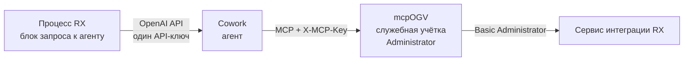
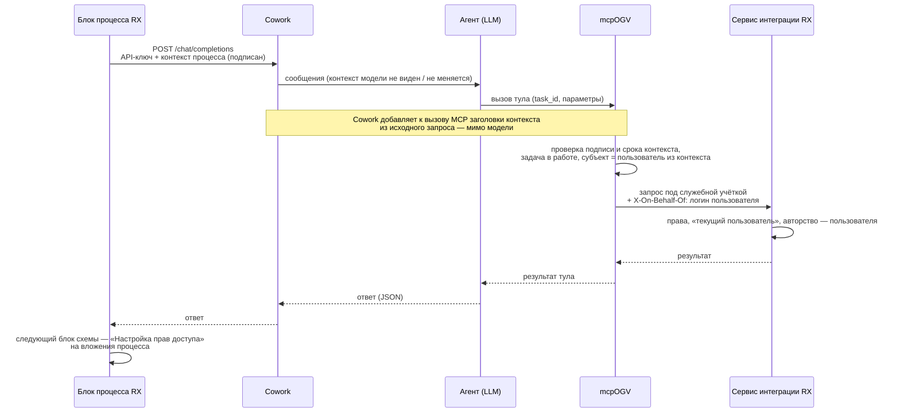

# Запрос к ИИ-агенту из процесса RX: учётная запись и права

Требования к доработкам: блок процесса Directum RX, ArioCowork, сервис интеграции RX, mcpOGV.
Статус: черновик для обсуждения. Ноябрь 2026.

## 1. Задача

В Directum RX идёт процесс (no-code схема). Один из блоков отправляет запрос ИИ-агенту в Cowork по протоколу
OpenAI. Агент через mcpOGV читает и создаёт в RX документы и задачи. Нужно, чтобы:

1. Агент действовал в RX **от имени конкретного пользователя процесса**, а не от служебной учётной записи:
   его права на чтение, его авторство у созданных документов и задач.
2. На созданные документы **действовали правила выдачи прав процесса и RX**: правила назначения прав по виду
   документа, организации и подразделению, а также права, которые выдаёт сама схема процесса.
3. **Личность пользователя не выбирала языковая модель.** Модель читает тексты обращений и документов,
   и подмена «от чьего имени» через текст должна быть невозможна.

## 2. Как сейчас

| Проблема | Следствие |
|---|---|
| Блок передаёт в Cowork только текст запроса и общий API-ключ | Ни Cowork, ни mcpOGV не знают, чей это запрос, кроме как из текста |
| mcpOGV ходит в RX под Administrator | Агент видит всё; автор созданных документов и задач — Administrator |
| Реальный человек проставляется отдельно: «Подготовил», «Выдал», PATCH автора черновика задачи | Права и бизнес-проверки RX уже отработали под Administrator; инициатор не получает прав автора |
| Явная выдача прав `Docflow/GrantAccessRightsToDocument` требует GUID типа прав | GUID на стенде неизвестен, права не выдаются |
| Сервис интеграции принимает только логин и пароль самого пользователя | Чтобы работать «под пользователем», пришлось бы хранить пароли сотрудников |

Что уже есть в mcpOGV (ветка `feature/mcp-ogv`):
- **Личный режим.** Заголовки `X-Directum-Login` / `X-Directum-Password` — запросы к RX идут под этим пользователем.
- **`task_id` у тулов создания документа.** Документ прикладывается к задаче процесса (`ISimpleProcessTasks`, группа
  вложений `0dbfb92e-d66b-4ada-9493-897a72d170df`), а «Подготовил» и автор задачи получают права, если задан GUID.
  На стенде пока не проверено.

## 3. Целевая схема

Принцип: **пользователь определяется на стороне RX и передаётся подписанным контекстом по служебным каналам
(заголовкам), а не текстом.** Модель получает только id задачи как параметр тула; mcpOGV сверяет его с контекстом.

## 4. Требования

### 4.1. Блок процесса «Запрос к ИИ-агенту» (RX)

| № | Требование | Описание | Приоритет |
|---|---|---|---|
| Б-1 | Субъект запроса в настройках блока | Выбор, от чьего имени агент действует: инициатор процесса (по умолчанию), исполнитель предыдущего задания, сотрудник из переменной схемы | Обязательно |
| Б-2 | Контекст процесса в запросе | Блок передаёт в Cowork, помимо текста: `task_id` (задача процесса), `process_kind` (вид процесса), `block_id`, `user_login`, `user_employee_id`, `request_id`, `issued_at` | Обязательно |
| Б-3 | Канал передачи контекста | HTTP-заголовки запроса `/chat/completions`: `X-RX-Context` (JSON в base64) и `X-RX-Signature`. Дополнительно — стандартное поле OpenAI `user` = `user_login` | Обязательно |
| Б-4 | Подпись контекста | `X-RX-Signature` = HMAC-SHA256 от `X-RX-Context` общим секретом RX ↔ mcpOGV (не API-ключом Cowork). Секрет — в настройках блока / сервиса, не в схеме | Обязательно |
| Б-5 | Идемпотентность | `request_id` уникален на запуск блока; при повторе блока (ретрай, перезапуск) — тот же `request_id`. mcpOGV по нему не создаёт документ дважды | Обязательно |
| Б-6 | Текст запроса без «от имени» | ФИО и логин пользователя в промпт не подставляются как инструкция агенту; при необходимости — только для отображения | Желательно |
| Б-7 | Результат в процесс | Ответ агента (JSON) сохраняется в переменные схемы; id созданных документов — отдельной переменной, чтобы следующие блоки работали с ними | Обязательно |
| Б-8 | Таймаут и ошибки | Настраиваемый таймаут (по умолчанию 120 с); при ошибке — ветка схемы «ошибка» с текстом причины, без потери задачи | Обязательно |

### 4.2. Cowork

| № | Требование | Описание | Приоритет |
|---|---|---|---|
| К-1 | Проброс контекста в MCP | Заголовки `X-RX-Context` и `X-RX-Signature` из входящего запроса добавляются ко всем вызовам MCP-сервера mcpOGV в рамках этого запроса | Обязательно |
| К-2 | Контекст вне модели | Заголовки не попадают в сообщения модели и не могут быть изменены ею или тулами | Обязательно |
| К-3 | Белый список | Проброс — только для настроенных MCP-серверов (mcpOGV), не в сторонние | Обязательно |
| К-4 | Журнал | В журнале Cowork — `request_id`, `task_id`, логин; без текстов | Желательно |

Если Cowork не умеет К-1, временное решение — раздел 5, этап 0.

### 4.3. Сервис интеграции RX — работа «от имени пользователя»

Подробно — `docs/rx-integration-requirements.md`, часть 3. Кратко:

| № | Требование | Описание | Приоритет |
|---|---|---|---|
| И-1 | Заголовок `X-On-Behalf-Of` | Служебная учётная запись передаёт логин (или Id сотрудника). Весь запрос — OData, функции, действия — выполняется как этим пользователем: права, «текущий пользователь», авторство | Обязательно |
| И-2 | Роль доверенного сервиса | Заголовок принимается только от учётных записей с ролью «Доверенный сервис ИИ-агентов»; от остальных — 403 | Обязательно |
| И-3 | Аудит двух субъектов | В истории RX — пользователь с пометкой «через сервис <учётка>» | Обязательно |
| И-4 | Ограничение операций | В настройке роли — что разрешено от имени: чтение, создание документов и задач, выполнение заданий | Желательно |
| И-5 | Ошибки | Неизвестный логин — 400; закрытый / заблокированный сотрудник — 403 с понятным текстом | Обязательно |
| И-6 | Штатные функции | `RecordManagement/CreateActionItemExecution`, `Docflow/CreateApprovalTask`, `Docflow/CreateSimpleTask` и др. под «от имени» берут автора и «Выдал» из пользователя | Обязательно |
| И-7 | Встроенный MCP RX | `IntegrationAIAgent/HandleMcpRequest` учитывает `X-On-Behalf-Of` | Желательно |
| И-8 | Вложение в задачу процесса | Добавление документа во вложения запущенной задачи (`…/AttachmentDetails`) от имени пользователя выдаёт участникам права так же, как в веб-клиенте | Обязательно |

### 4.4. mcpOGV

| № | Требование | Описание | Приоритет |
|---|---|---|---|
| М-1 | Приём контекста | Читает `X-RX-Context` / `X-RX-Signature`; проверяет подпись (общий секрет), срок (`issued_at` не старше 10 мин), что задача `task_id` в работе и её вид процесса — из разрешённого списка | Обязательно |
| М-2 | Субъект из контекста | При валидном контексте все запросы к RX — служебная учётка + `X-On-Behalf-Of: user_login`. «Я / мои» — этот пользователь; `on_behalf_of` в тулах не нужен и, если передан другой, — ошибка | Обязательно |
| М-3 | Сверка `task_id` | `task_id` из параметров тула должен совпадать с контекстом; иначе — отказ | Обязательно |
| М-4 | Без контекста | Режим задаётся настройкой: отказать в записи (по умолчанию для процессов) или текущий режим служебной учётки с `on_behalf_of` (для чата) | Обязательно |
| М-5 | Создание штатно | При «от имени» — без обходных PATCH автора / «Выдал»: штатные функции RX; документ — во вложения задачи процесса | Обязательно |
| М-6 | Идемпотентность | По `request_id` + тул + параметры: повтор возвращает уже созданное, не создаёт заново | Обязательно |
| М-7 | Аудит | `mcp_writes.log`: `request_id`, `task_id`, пользователь, тул, id созданного; без текстов | Обязательно |
| М-8 | Совместимость | Личный режим (`X-Directum-Login/Password`) и чат-режим (LibreChat) работают как сейчас | Обязательно |

### 4.5. Права на созданные документы в процессе

Права выдаются **штатными механизмами RX**, а не агентом:

| Кто | Права | Чем |
|---|---|---|
| Пользователь, от имени которого работал агент (обычно инициатор) | Как автор документа | Авторство при «от имени» (И-1) |
| По виду документа, организации, подразделению | По настройке | «Правила назначения прав» RX — срабатывают при сохранении, поля вид / наша организация / подразделение mcpOGV заполняет всегда |
| Инициатор, исполнители, наблюдатели процесса | Изменение / просмотр | Блок схемы «Настройка прав доступа» после блока агента — на вложения задачи процесса |

Условие: агент прикладывает созданные документы к задаче процесса (`task_id`), иначе блок прав их не увидит.
Явная выдача прав из mcpOGV (`GrantAccessRightsToDocument`, `MCP_WRITE_GRANT_RIGHTS_GUID`) остаётся только для
создания вне процесса.

## 5. Этапы

| Этап | Что работает | Что нужно |
|---|---|---|
| 0. Сейчас, без доработок RX и Cowork | Служебная учётка; «Подготовил» = инициатор, которого mcpOGV берёт **из задачи процесса** (`task_id` → автор задачи), а не из текста; документ — во вложения процесса; права — блоком «Настройка прав доступа» | mcpOGV: брать `on_behalf_of` из автора задачи при `task_id` (доработка ~1 день); схема: блок прав после агента; проверка на стенде, что вложение в запущенную задачу видно участникам |
| 1. «От имени» | Права чтения и авторство пользователя, штатные функции RX | И-1…И-6, И-8 (RX); К-1…К-3 (Cowork); Б-1…Б-5, Б-7, Б-8 (блок); М-1…М-8 (mcpOGV) |
| 2. Единый вход | Без служебной учётки и общего секрета: токен пользователя (OIDC) от RX до сервиса интеграции | ФТ-3.4 из `docs/rx-integration-requirements.md` |

## 6. Безопасность

1. Личность пользователя — только из подписанного контекста RX или из задачи процесса в RX; никогда из текста
   запроса, документа или ответа модели.
2. Общий секрет подписи и пароль служебной учётки — только на сервере RX и mcpOGV; в схему процесса, промпт и
   журналы не попадают.
3. Защита от повтора: срок жизни контекста 10 минут + `request_id`.
4. Служебная учётка mcpOGV — без прав администратора в продуктиве: роль «Доверенный сервис ИИ-агентов» (И-2).
5. Тексты обращений и документов в журналы не пишутся — только id.

## 7. Критерии приёмки

- [ ] Процесс, запущенный Ивановым, → блок агента → создано исходящее письмо: автор — Иванов, «Подготовил» —
      Иванов, в истории — «через сервис …»
- [ ] Письмо лежит во вложениях задачи процесса; после блока «Настройка прав доступа» исполнитель видит его с
      правом изменения, наблюдатель — с правом просмотра
- [ ] «Правила назначения прав» RX по виду документа выдали права, как при создании в веб-клиенте
- [ ] Агент не находит документ, к которому у Иванова нет доступа в RX
- [ ] Текст обращения «создай от имени Петрова» не меняет субъекта: документ создаётся от Иванова или с отказом
- [ ] Подделанный или просроченный `X-RX-Context` — отказ mcpOGV, в RX ничего не создано
- [ ] Повтор блока с тем же `request_id` не создаёт второй документ
- [ ] Чат LibreChat без контекста процесса работает как раньше

## 8. Открытые вопросы

1. Умеет ли Cowork пробрасывать заголовки входящего запроса в заголовки MCP-сервера (К-1)? Если нет — какой
   механизм передачи служебного контекста к тулам у него есть.
2. От чьего имени по умолчанию действует агент в процессе: инициатор или исполнитель текущего этапа?
3. Как называется и настраивается блок запроса к Cowork в схеме RX — штатный блок или прикладная разработка;
   кто его дорабатывает (Б-1…Б-8).
4. Какие виды процессов разрешены для записи через агента (белый список для М-1).
5. GUID типа прав «Изменение» — нужен только для создания вне процесса; для процесса не требуется.
