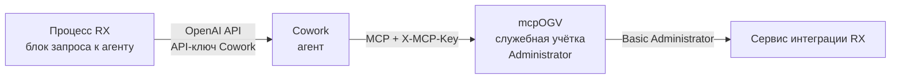
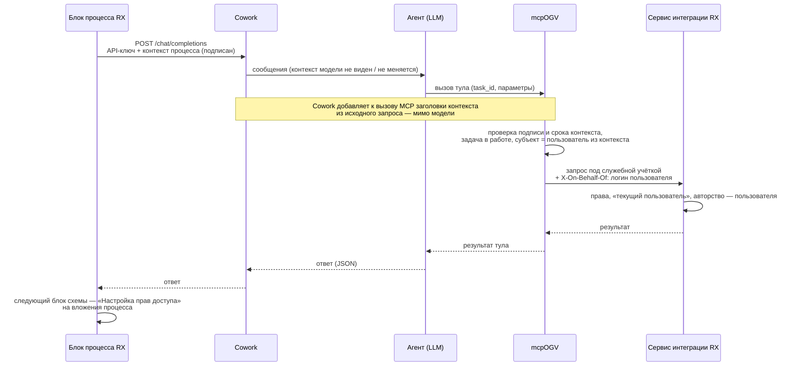

# Запрос к ИИ-агенту из процесса RX: учётная запись и права

Как добиться, чтобы агент, вызванный из процесса Directum RX, работал в RX от имени нужного пользователя и с его
правами. Два варианта решения, инструкции по каждому, требования к доработкам: блок процесса RX, ArioCowork,
сервис интеграции RX, mcpOGV.
Статус: черновик для обсуждения. Ноябрь 2026. Проверки на стенде 68 (`https://governmentgenai.directum360.ru/`) —
раздел 6.

## 1. Задача

В Directum RX идёт процесс (no-code схема). Один из блоков отправляет запрос ИИ-агенту в Cowork по протоколу
OpenAI. Агент через mcpOGV читает и создаёт в RX документы и задачи. Нужно, чтобы:

1. Агент действовал в RX **от имени конкретного пользователя процесса**: его права на чтение, его авторство у
   созданных документов и задач.
2. На созданные документы **действовали правила выдачи прав RX и процесса**: правила назначения прав по виду
   документа, организации и подразделению и права, которые выдаёт сама схема.
3. **Пользователя не выбирала языковая модель.** Модель читает тексты обращений и документов, и подмена «от чьего
   имени» через текст должна быть невозможна.

## 2. Как сейчас



| Проблема | Следствие |
|---|---|
| mcpOGV на стенде ходит в RX под Administrator | Агент видит всё; автор созданных документов и задач — Administrator |
| Реальный человек проставляется отдельно («Подготовил», «Выдал», PATCH автора черновика задачи) | Права и проверки RX отработали под Administrator; сотрудник не получает прав автора |
| Вложение документа служебной учёткой в задачу прав участникам не даёт (проверено, раздел 6) | Сотрудник не видит созданный для него документ |
| `Docflow/GrantAccessRightsToDocument` требует GUID типа прав | GUID неизвестен — права не выдаются |
| **RX не знает паролей пользователей** | Блок процесса не может сам положить в запрос `Authorization: Basic` пользователя — только его логин |

Что уже есть в mcpOGV (ветка `feature/mcp-ogv`):

| Возможность | Как |
|---|---|
| **Личный режим** | Заголовки `X-Directum-Login` + `X-Directum-Password` **или** `Authorization: Basic base64(логин:пароль)` (передаётся в сервис интеграции как есть). Все запросы к RX — под этим пользователем; служебная учётка не используется |
| Служебная учётка | Без личных заголовков и при `MCP_ALLOW_ENV_CREDENTIALS=true` — учётка из окружения (`DIRECTUM_AUTH_TOKEN`), флаг `service_account=true` |
| `task_id` у тулов создания документа | Документ прикладывается к задаче процесса; «Подготовил» = автор задачи; задача должна быть в работе и из разрешённых типов (`MCP_WRITE_PROCESS_TASK_TYPES`, по умолчанию `ISimpleProcessTasks`); повтор с той же темой возвращает уже созданный документ |

## 3. Два варианта решения

| | Вариант 1. Личная учётка пользователя | Вариант 2. Служебная учётка «от имени» |
|---|---|---|
| Суть | Каждому пользователю RX — свой пользователь Cowork; его логин и пароль RX хранятся в Cowork и уходят в mcpOGV заголовками | mcpOGV один под служебной учёткой; RX выполняет запросы как пользователь по его логину |
| Кто определяет пользователя | Блок процесса — выбором пользователя Cowork (API-ключа), от имени которого вызывает агента | Блок процесса — подписанным контекстом с логином инициатора |
| Доработки RX | Нет | Метод «от имени» в сервисе интеграции (И-1…И-8) + доработка блока (Б-1…Б-8) |
| Доработки Cowork | Нет (если работают личные переменные MCP по API — проверить) | Проброс заголовков контекста в MCP (К-1…К-4) |
| Доработки mcpOGV | Нет — уже работает | М-1…М-8 |
| Пароли | Хранятся в Cowork (по пользователю) | Не хранятся; только пароль служебной учётки на сервере mcpOGV |
| Масштаб | Единицы–десятки пользователей: каждому — пользователь Cowork и ветка в схеме | Любой |
| Готовность | **Сейчас — для демо и пилота** | После доработок RX и Cowork — для продуктива |

Рекомендация: **вариант 1 — для демо сейчас** (на одном–двух пользователях, например nadya); **вариант 2 — целевой**,
требования передать разработчикам RX и Cowork.

## 4. Вариант 1. Личная учётка пользователя (демо, без доработок RX)

### 4.1. Схема


Пользователь определяется **выбором API-ключа Cowork** в блоке процесса: ключ принадлежит пользователю Cowork, а
личные переменные (`customUserVars`) этого пользователя Cowork подставляет в заголовки MCP-подключения. Модель на
это не влияет.

### 4.2. Пошаговая настройка

**Шаг 1. RX — пользователь.**
- Учётная запись пользователя (например, `nadya` — Концева Н. И., id 63) с доступом к сервису интеграции
  (`/Integration/odata`) и правами на создание нужных видов документов (вид, регистрация, нумерация — как в
  веб-клиенте).
- Проверка доступа: `GET https://governmentgenai.directum360.ru/Integration/odata/$metadata` под этой учёткой → 200,
  без кредов — 401. Коллекции стенд без `$filter` не отдаёт — для проверки не годятся.

**Шаг 2. mcpOGV — версия и настройки.**
- Код ветки `feature/mcp-ogv` не старше коммита с поддержкой `Authorization: Basic` и этапа 0 (ноябрь 2026).
- Переменные окружения mcpOGV (в `run.ps1` / окружении процесса; `.env` в репозитории не трогать):
  - `MCP_OGV_KEY` — общий ключ, тот же, что в настройке MCP в Cowork;
  - `MCP_WRITE_ENABLED=true` — если агент создаёт документы;
  - `MCP_WRITE_PROCESS_TASK_TYPES=ISimpleProcessTasks` — типы задач, к которым агент прикладывает документы
    (для теста на простой задаче — `ISimpleProcessTasks,ISimpleTasks`);
  - `MCP_ALLOW_ENV_CREDENTIALS` — можно оставить `true` для других агентов, но тогда запрос без личных заголовков
    уйдёт под служебной учёткой. Для чистого личного режима — `false` (без кредов — понятная ошибка).
- Проверка: `GET http://<хост mcpOGV>:8010/health` → `{"status":"ok"}`.

**Шаг 3. Cowork — MCP-сервер с личными переменными** (`librechat.yaml` Cowork, по образцу
`docs/mcp-ogv/librechat.example.yaml`):

```yaml
mcpServers:
  mcpOGV:
    type: streamable-http
    url: http://<хост mcpOGV>:8010/mcp
    headers:
      X-MCP-Key: '${MCP_OGV_KEY}'
      X-Directum-Login: '{{DRX_LOGIN}}'
      X-Directum-Password: '{{DRX_PASSWORD}}'
    customUserVars:
      DRX_LOGIN:
        title: 'Логин Directum RX'
        description: 'Ваш логин в Directum RX. Доменный — домен\логин.'
      DRX_PASSWORD:
        title: 'Пароль Directum RX'
        description: 'Хранится в Cowork, в mcpOGV не сохраняется и не логируется.'
    serverInstructions: true
    timeout: 120000
```

- Если в Cowork нет личных переменных, используйте вариант 1б (п. 4.4).
- `X-Directum-Login/Password` надёжнее, чем `Authorization`: Cowork может сам занимать `Authorization` у
  MCP-подключения.

**Шаг 4. Cowork — пользователь и его креды.**
- Завести пользователя Cowork на каждого пользователя RX (например, `nadya`).
- Войти под ним → настройки MCP-сервера mcpOGV → ввести `DRX_LOGIN` / `DRX_PASSWORD` (логин и пароль RX).
- Дать ему доступ к агенту ОГВ (общий агент с тем же промптом и навыками; в агенте отмечены тулы mcpOGV).
- Создать **API-ключ** этого пользователя Cowork — им блок процесса будет вызывать агента.

**Шаг 5. Схема процесса RX — блок запроса к Cowork.**
- Адрес: OpenAI-совместимый endpoint агентов Cowork (`…/chat/completions`), `model` = id агента ОГВ.
- Авторизация: `Authorization: Bearer <API-ключ пользователя Cowork инициатора>`.
- Несколько демо-пользователей — развилка в схеме по инициатору: каждой ветке — свой API-ключ (или таблица
  соответствия «сотрудник → ключ» в настройках блока).
- В тексте запроса — id задачи процесса: «Задача RX: <id>». Агент передаёт его в `task_id` тула создания документа
  (правило 15 инструкций mcpOGV) — документ приложится к задаче, «Подготовил» = автор задачи.

**Шаг 6. Проверка.**
1. Запустить процесс от `nadya`, дойти до блока агента.
2. В ответе агента — id созданного документа.
3. В веб-клиенте RX под `nadya`: документ открывается; в карточке **«Автор» — Концева Н. И.**, «Подготовил» — она же;
   документ во вложениях задачи процесса.
4. Под другим пользователем без прав документ не виден.
5. Повторный запуск блока не создаёт второй документ (та же тема в той же задаче).

### 4.3. Ограничения варианта 1

- Пароли пользователей RX хранятся в Cowork. Смена пароля в RX — обновить `DRX_PASSWORD` в Cowork.
- Каждому пользователю — пользователь Cowork, API-ключ и ветка в схеме: подходит для демо и пилота, не для всех
  сотрудников.
- Не проверено: подставляет ли Cowork личные переменные пользователя при вызове агента **по API-ключу** (а не из
  чата). Проверить первым делом: в журнале mcpOGV вызов `get_current_user` должен вернуть пользователя, а не
  ошибку «Укажите логин и пароль».
- Если ключ уйдёт, им можно действовать от имени пользователя — хранить ключи в настройках блока, не в схеме.

### 4.4. Вариант 1б — отдельный агент со «вшитой» учёткой

Если в Cowork нет личных переменных: отдельный агент (или отдельное MCP-подключение) на пользователя, в заголовках
подключения — постоянные `X-Directum-Login` / `X-Directum-Password` этого пользователя или
`Authorization: Basic <base64(логин:пароль)>` (base64 — в консоли браузера: `btoa("nadya:пароль")`, доменный —
`btoa("nt_work\\user:пароль")`). Блок процесса вызывает агента этого пользователя. Минус — пароль в конфигурации
агента, видимой администратору Cowork.

## 5. Вариант 2. Служебная учётка «от имени» (целевой, нужны доработки)

### 5.1. Схема



Принцип: пользователь определяется на стороне RX и передаётся **подписанным контекстом по служебным каналам**
(заголовкам), а не текстом. Модель получает только id задачи; mcpOGV сверяет его с контекстом. Пароли
пользователей нигде не хранятся.

### 5.2. Блок процесса «Запрос к ИИ-агенту» (RX)

| № | Требование | Описание | Приоритет |
|---|---|---|---|
| Б-1 | Субъект запроса в настройках блока | От чьего имени агент действует: инициатор процесса (по умолчанию), исполнитель предыдущего задания, сотрудник из переменной схемы | Обязательно |
| Б-2 | Контекст процесса в запросе | `task_id`, `process_kind`, `block_id`, `user_login`, `user_employee_id`, `request_id`, `issued_at` | Обязательно |
| Б-3 | Канал передачи контекста | Заголовки запроса `/chat/completions`: `X-RX-Context` (JSON в base64) и `X-RX-Signature`; дополнительно поле OpenAI `user` = `user_login` | Обязательно |
| Б-4 | Подпись контекста | `X-RX-Signature` = HMAC-SHA256 от `X-RX-Context` общим секретом RX ↔ mcpOGV (не API-ключом Cowork); секрет — в настройках блока, не в схеме | Обязательно |
| Б-5 | Идемпотентность | `request_id` уникален на запуск блока; при повторе — тот же | Обязательно |
| Б-6 | Текст запроса без «от имени» | ФИО и логин в промпт не подставляются как указание агенту | Желательно |
| Б-7 | Результат в процесс | Ответ агента (JSON) — в переменные схемы; id созданных документов — отдельной переменной | Обязательно |
| Б-8 | Таймаут и ошибки | Настраиваемый таймаут (по умолчанию 120 с); ошибка — ветка схемы с причиной | Обязательно |

### 5.3. Cowork

| № | Требование | Описание | Приоритет |
|---|---|---|---|
| К-1 | Проброс контекста в MCP | `X-RX-Context` и `X-RX-Signature` из входящего запроса добавляются ко всем вызовам mcpOGV в рамках запроса | Обязательно |
| К-2 | Контекст вне модели | Заголовки не попадают в сообщения модели и не меняются ею или тулами | Обязательно |
| К-3 | Белый список | Проброс — только в настроенные MCP-серверы (mcpOGV) | Обязательно |
| К-4 | Журнал | `request_id`, `task_id`, логин; без текстов | Желательно |

### 5.4. Сервис интеграции RX — «от имени пользователя»

Подробно — `docs/rx-integration-requirements.md`, часть 3.

| № | Требование | Описание | Приоритет |
|---|---|---|---|
| И-1 | Заголовок `X-On-Behalf-Of` | Служебная учётная запись передаёт логин (или Id сотрудника); весь запрос — OData, функции, действия — выполняется как этим пользователем: права, «текущий пользователь», авторство | Обязательно |
| И-2 | Роль доверенного сервиса | Заголовок принимается только от учётных записей с ролью «Доверенный сервис ИИ-агентов»; иначе 403 | Обязательно |
| И-3 | Аудит двух субъектов | В истории RX — пользователь с пометкой «через сервис <учётка>» | Обязательно |
| И-4 | Ограничение операций | В настройке роли — что разрешено от имени: чтение, создание документов и задач, выполнение заданий | Желательно |
| И-5 | Ошибки | Неизвестный логин — 400; закрытый / заблокированный сотрудник — 403 | Обязательно |
| И-6 | Штатные функции | `CreateActionItemExecution`, `CreateApprovalTask`, `CreateSimpleTask` и др. под «от имени» берут автора и «Выдал» из пользователя | Обязательно |
| И-7 | Встроенный MCP RX | `IntegrationAIAgent/HandleMcpRequest` учитывает `X-On-Behalf-Of` | Желательно |
| И-8 | Вложение в задачу процесса | Добавление документа во вложения запущенной задачи выдаёт участникам права так же, как в веб-клиенте. Сейчас служебной учёткой — **не выдаёт** (раздел 6) | Обязательно |

### 5.5. mcpOGV

| № | Требование | Описание | Приоритет |
|---|---|---|---|
| М-1 | Приём контекста | Проверка подписи `X-RX-Context` / `X-RX-Signature`, срока (`issued_at` не старше 10 мин), задача `task_id` в работе и из разрешённого списка | Обязательно |
| М-2 | Субъект из контекста | Запросы к RX — служебная учётка + `X-On-Behalf-Of: user_login`; «я / мои» — этот пользователь; иной `on_behalf_of` — ошибка | Обязательно |
| М-3 | Сверка `task_id` | `task_id` тула совпадает с контекстом, иначе отказ | Обязательно |
| М-4 | Без контекста | Настройка: отказ в записи (для процессов) или режим служебной учётки с `on_behalf_of` (для чата) | Обязательно |
| М-5 | Создание штатно | Без обходных PATCH автора / «Выдал»; документ — во вложения задачи процесса | Обязательно |
| М-6 | Идемпотентность | По `request_id` + тул + параметры (сейчас — по теме документа в задаче) | Обязательно |
| М-7 | Аудит | `request_id`, `task_id`, пользователь, тул, id созданного; без текстов | Обязательно |
| М-8 | Совместимость | Личный режим (вариант 1) и чат работают как сейчас | Обязательно |

### 5.6. Права на документы в процессе (оба варианта)

| Кто | Права | Чем |
|---|---|---|
| Пользователь, от имени которого работал агент | Как автор документа | Вариант 1 — личная учётка (проверено); вариант 2 — «от имени» (И-1) |
| По виду документа, организации, подразделению | По настройке | «Правила назначения прав» RX при сохранении; вид, наша организация, подразделение mcpOGV заполняет всегда |
| Инициатор, исполнители, наблюдатели процесса | Изменение / просмотр | Блок схемы «Настройка прав доступа» после блока агента — на вложения задачи процесса (не проверено) |

Условие для блока прав: агент прикладывает созданные документы к задаче процесса (`task_id`). Явная выдача прав из
mcpOGV (`GrantAccessRightsToDocument`, `MCP_WRITE_GRANT_RIGHTS_GUID`) — запасной путь для служебной учётки; GUID
типа прав пока неизвестен.

## 6. Проверено на стенде 01.11.2026

mcpOGV запущен локально с последним кодом, обращается к стенду 68. Простая задача 86316: автор — nadya (Концева Н. И.,
id 63), исполнитель — Ким Д. А.

| Проверка | Результат |
|---|---|
| «Подготовил» без `on_behalf_of` при `task_id` | Автор задачи — Концева Н. И. |
| Чужой `on_behalf_of`, завершённая задача, поручение вместо процесса, несуществующий id | Понятные отказы, ничего не создано |
| Вложение в запущенную задачу | Приложено; у простой задачи вложения без группы — mcpOGV кладёт так же |
| Повтор с той же темой | Возвращён тот же документ, дубля нет |
| **Служебная учётка**: письмо 16931 | Автор — Administrator. **nadya документ не видит** (нет прав), хотя он во вложениях её задачи |
| `GrantAccessRightsToDocument` без GUID | 400: `Unable to parse access rights Guid string` |
| **Личная учётка** (`Authorization: Basic` nadya): письмо 16932 | **Автор — Концева Н. И.**, «Подготовил» — она же, во вложениях задачи; **nadya видит документ**; `get_current_user` — она |

Вывод: вариант 1 работает на стороне mcpOGV и RX без доработок; под служебной учёткой без «от имени», GUID или блока
прав сотрудник созданного документа не видит.

## 7. Порядок работ

| Шаг | Что | Кто |
|---|---|---|
| 1 | Обновить mcpOGV на стенде до текущего кода ветки `feature/mcp-ogv` | Команда mcpOGV |
| 2 | Вариант 1 для демо: пользователь Cowork `nadya`, личные переменные, API-ключ, блок процесса с ним (раздел 4.2); проверка по шагу 6 | Команда прототипа |
| 3 | Блок «Настройка прав доступа» после блока агента — права исполнителям и наблюдателям | Аналитик схемы процесса |
| 4 | Требования варианта 2 (5.2–5.4) — разработчикам RX и Cowork | Владелец продукта |
| 5 | mcpOGV: М-1…М-8 под флагом, по готовности RX и Cowork | Команда mcpOGV |
| 6 | Единый вход по токенам (OIDC) вместо служебной учётки — ФТ-3.4 `docs/rx-integration-requirements.md` | Перспектива |

## 8. Безопасность

1. Пользователь определяется только выбором API-ключа Cowork (вариант 1) или подписанным контекстом RX (вариант 2);
   никогда — текстом запроса, документа или ответа модели.
2. Пароли пользователей (вариант 1) — только в личных переменных Cowork; пароль служебной учётки и секрет подписи
   (вариант 2) — только на серверах RX и mcpOGV. В схему процесса, промпт и журналы не попадают.
3. API-ключи пользователей Cowork — в настройках блока, не в тексте схемы.
4. Защита от повтора: срок жизни контекста 10 минут + `request_id` (вариант 2); тема документа в задаче (сейчас).
5. Служебная учётка mcpOGV в продуктиве — без прав администратора: роль «Доверенный сервис ИИ-агентов» (И-2).
6. Тексты обращений и документов в журналы не пишутся — только id.

## 9. Критерии приёмки

Вариант 1:
- [ ] Процесс от `nadya` → блок агента → исходящее письмо: «Автор» и «Подготовил» — Концева Н. И.
- [ ] `nadya` открывает документ в веб-клиенте; пользователь без прав — нет
- [ ] Документ во вложениях задачи процесса; повтор блока не создаёт второй
- [ ] Вызов агента по API-ключу `nadya` в Cowork доходит до mcpOGV с её логином (`get_current_user` — она)

Вариант 2:
- [ ] Процесс, запущенный Ивановым → письмо: автор — Иванов, в истории — «через сервис …»
- [ ] После блока «Настройка прав доступа» исполнитель видит письмо с правом изменения, наблюдатель — просмотра
- [ ] Агент не находит документ, к которому у Иванова нет доступа
- [ ] Текст «создай от имени Петрова» не меняет субъекта
- [ ] Подделанный или просроченный `X-RX-Context` — отказ, ничего не создано
- [ ] Повтор блока с тем же `request_id` — без второго документа
- [ ] Чат без контекста процесса работает как раньше

## 10. Открытые вопросы

1. Cowork: подставляются ли личные переменные пользователя (`customUserVars`) в заголовки MCP при вызове агента по
   API-ключу? Есть ли OpenAI-совместимый endpoint агентов и как задаётся агент (`model`)?
2. Cowork: умеет ли пробрасывать заголовки входящего запроса в MCP (К-1) — для варианта 2.
3. От чьего имени по умолчанию действует агент в процессе: инициатор или исполнитель текущего этапа?
4. Блок запроса к Cowork в схеме RX — штатный или прикладная разработка; где хранить API-ключи и секрет подписи.
5. Какие виды процессов разрешены для записи через агента (`MCP_WRITE_PROCESS_TASK_TYPES`).
6. GUID типа прав «Изменение» — нужен только для служебной учётки без «от имени».
